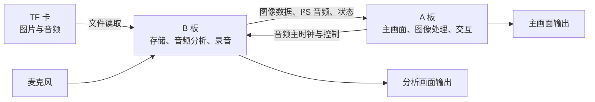

# 听见·看见：双 FPGA 音画教学平台

基于两片安路 FPGA 的交互式教学展示平台。系统从 TF 卡读取图片与音频，通过主画面呈现教学内容，并在独立分析画面上展示频谱、声谱和波形，配合麦克风、录音与交互控制，辅助开展音频听辨和信号分析教学。

## 主要功能

- **图像与音频**：读取 10 张 BMP 图片和 4 段 WAV 音频，支持页面切换、图像缩放、转场、字幕和音频播放。
- **声音分析**：对音乐或麦克风等声源进行 512 点 FFT 分析，将结果映射为 16 个显示频段，并提供频谱、声谱及波形视图。
- **交互与录音**：支持菜单、实体按键、红外遥控及语音相关操作，提供声源和声道切换、暂停、静音、保持以及录音保存与回放功能。
- **节能演示**：在指定场景下，可通过“分析 → 分析视图 → 节能”使 B 板分析与显示进入休眠，同时保留 A 板画面和音乐；退出后恢复相关功能。

## 系统架构



| 部分 | 主要职责 |
|---|---|
| **A 板** | 主画面、SDRAM 图像缓存、缩放与转场、字幕和菜单、音频处理；向 B 板提供音频主时钟。 |
| **B 板** | TF 卡读取、音频播放数据与跨板传输、FFT 和分析显示、麦克风采样、录音及回放。 |

512 点是 FFT 的运算长度，16 个频段是面向显示的汇总结果；两个数字对应不同层次。

## 工程环境

- FPGA 器件：`EG4S20BG256`，A、B 两板各一片。
- 开发工具：安路 **TD 6.2.168116**；当前工程在 Windows 环境下整理。
- 硬件描述语言：Verilog / VHDL，工程包含厂商加密 IP、头文件和 ROM 初始化数据。
- 运行素材：10 张 BMP 和 4 段 WAV，见 [TF_Card_Media](TF_Card_Media/)。

## 仓库结构

```text
.
├── A_board/                A 板 TD 工程、源码、IP 支持和约束
├── B_board/                B 板 TD 工程、源码、初始化数据和约束
├── Firmware/               双板 .bit 位流与配套 .bmk 掩码
├── TF_Card_Media/          10 张图片和 4 段音频素材
├── Support/                编入清单、约束及历史辅助脚本
├── Simulation_reference/   父版与定向验证的参考测试源码
├── README_检查说明.md      文件夹和工程迁移说明
├── 源码与固件检查报告.md   源码覆盖及固件身份核对
└── 固件及素材校验清单.txt  固件和素材的 SHA-256
```

工程入口为 [A_board/scene_a_top.al](A_board/scene_a_top.al) 和 [B_board/scene_b_top.al](B_board/scene_b_top.al)。常用源码入口：

| 文件 | 作用 |
|---|---|
| [A_board/source/a_top.v](A_board/source/a_top.v) | A 板顶层及主要模块连接 |
| [A_board/source/audio_fx.v](A_board/source/audio_fx.v) | 音频滤波处理 |
| [B_board/source/b_top.v](B_board/source/b_top.v) | B 板顶层及主要模块连接 |
| [B_board/source/fft_spectrum.v](B_board/source/fft_spectrum.v) | 512 点 FFT 分析 |
| [B_board/source/scene_analysis_windows.v](B_board/source/scene_analysis_windows.v) | 音频分析窗口和缓存 |
| [B_board/source/record_engine.v](B_board/source/record_engine.v) | 录音与回放控制 |
| [B_board/source/low_power_control.v](B_board/source/low_power_control.v) | 节能状态控制 |

## 工程和位流使用

1. 安装安路 TD，并分别打开 A、B 两板的 `.al` 工程。工程文件中保留了原工作区路径；迁移目录或换电脑后，请在 TD 中核对工程根路径及源码引用。
2. `source/` 中的头文件、字库、系数以及工程根目录下的对应副本均属于原工程布局。A 板 `user_source/` 包含 SDRAM IP 的配套文件。
3. 下载时先按实际接线确认板卡角色，使用对应板的位流：

   | 板卡 | 位流 | 配套读回掩码 |
   |---|---|---|
   | A | [A_scene_a.bit](Firmware/A_board/A_scene_a.bit) | [A_scene_a.bmk](Firmware/A_board/A_scene_a.bmk) |
   | B | [B_scene_b.bit](Firmware/B_board/B_scene_b.bit) | [B_scene_b.bmk](Firmware/B_board/B_scene_b.bmk) |

   `.bmk` 是读回掩码，不单独作为烧录位流。A 板为 B 板提供音频 MCLK，重新配置 A 板时需考虑 B 板的恢复。
4. **TF 卡不是普通的文件复制即可替换**：工程中的素材表绑定了原卡的绝对物理扇区地址。新卡或重新制作的卡需要核对实际布局并相应处理固件绑定，详见 [素材说明](TF_Card_Media/README_素材说明.md)。

`Support/` 中保留的历史构建、审核及硬件操作脚本可能依赖旧路径、报告或数据库，尚未验证在新环境下独立运行。普通 TD 图形界面构建不自动等同于原版包含原生保护、物理约束重绑定和审核的签核流程。

## 已记录的实现与验证

当前源码整理版对应的最终配对为 **A seed 7 / B seed 5**。下表为既有全板物理实现结果，时序单位为 ns：

| 指标 | A 板 | B 板 |
|---|---:|---:|
| MSLICE | 4730 / 4900 | 4655 / 4900 |
| LUT | 18468 | 18211 |
| REG | 11641 | 10166 |
| BRAM9K / BRAM32K | 46 / 10 | 41 / 11 |
| DSP | 20 | 7 |
| Setup WNS | +0.170 | +0.788 |
| Hold WNS | +0.023 | +0.020 |

两板记录的最终布线冲突为 0、TNS / THS 为 0、STA 覆盖为 100%。该次源码整理未改动非注释代码，相关功能仿真证据按已有记录复用；上述物理结果不代替实板功能验收。

已有记录显示，两板配置 Flash 曾完成原厂校验、完整读回和目标 SRAM 恢复后的短启动数字检查。**独立断电启动以及外接屏幕、听音、实体操作和录音等体验，仍以现场验收记录为准。** 源码、固件和素材的核对范围见 [检查报告](源码与固件检查报告.md)。
